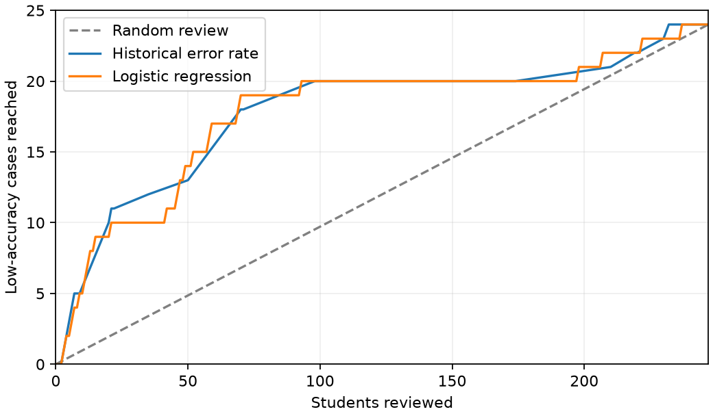

# Student Knowledge Tracing on EdNet

We asked two questions about English practice logs. Can we predict whether a student will answer a new question correctly? And after about 20 answers, can we identify students who will get fewer than 40% of their next 20 questions right?

## Data

We selected 5,000 students from EdNet-KT1 using seed 42. We joined their answers to the question table and retained 653,911 of 654,035 responses. The removed rows included 112 invalid answers and 12 duplicates. We split by student into 3,512 training, 495 validation, and 993 test students. Every prediction uses answers available before its cutoff. In particular, questions from the same solving round share one cutoff.

## Predicting the next answer

We compared smoothed historical accuracy with DKT and SAKT using up to 50 past answers. Both learned models used the first skill tag and the TOEIC part. We held out roughly one fifth of question bundles by a fixed hash and excluded their responses from training, validation, and input histories. The test comparison covered the same 659 students, with 119,423 seen-bundle and 29,727 unseen-bundle targets.

| Model | Seen ROC-AUC | Unseen ROC-AUC | Drop (95% CI) |
|---|---:|---:|---:|
| Historical accuracy | 0.629 | 0.624 | 0.005 (−0.003 to 0.015) |
| DKT | 0.658 | 0.636 | 0.022 (0.016 to 0.033) |
| SAKT | 0.660 | 0.634 | 0.025 (0.018 to 0.036) |

For DKT and SAKT, we averaged predicted probabilities across three training seeds before scoring. The intervals come from 1,000 paired bootstrap draws of the test students. Both sequence models ranked answers better on seen bundles, and their advantage narrowed on unseen bundles. The bundle groups differ in question mix, so the drop cannot be attributed to novelty alone.

On a fixed set of seen-bundle targets with at least 50 prior answers, cutting the available history to five lowered mean per-seed AUC from 0.645 to 0.609 for DKT and from 0.644 to 0.600 for SAKT. The calibration plots show how predicted probabilities compare with observed accuracy. [Training details and calibration](../results/knowledge_tracing.md)

## Early low-accuracy alerts

We make one prediction at the first completed round after at least 20 answers. The label records whether accuracy on the next 20 answers is below 40%. Only 1,277 of the 5,000 students had both windows. In the training split, students who reached the cutoff but lacked enough follow-up averaged 45.9% at the cutoff, compared with 52.1% for those with complete outcomes. The risk evaluation therefore covers a selected group of students. [Label coverage and threshold sensitivity](../results/risk_eda.md)

In the 247 labeled test students, 24 met the risk definition. Historical error rate had higher average precision than logistic regression (0.379 vs. 0.349). At thresholds selected separately on validation, logistic regression found 20 cases with 98 alerts, compared with 13 cases and 50 alerts for historical error rate.

The figure compares the rankings at equal review budgets. With 50 slots, logistic regression reached 14 cases and historical error rate reached 13. With 100 slots both reached 20. The fractional counts at some budgets average over students tied at the cutoff. The dashed line shows expected coverage from random review.

## What the results support

The sequence models improved next-answer ranking on this sample, especially on familiar bundles. For early alerts, the simple historical score remained competitive at the same review budget. The risk results come from only 24 positive test cases and omit students whose follow-up is missing. The platform also chooses the next questions, so low accuracy may reflect question difficulty as well as the student's learning. The logs cannot tell us whether contacting a flagged student would improve their outcomes.

Start with the [README](../README.md) to reproduce the sample, splits, and analyses.
