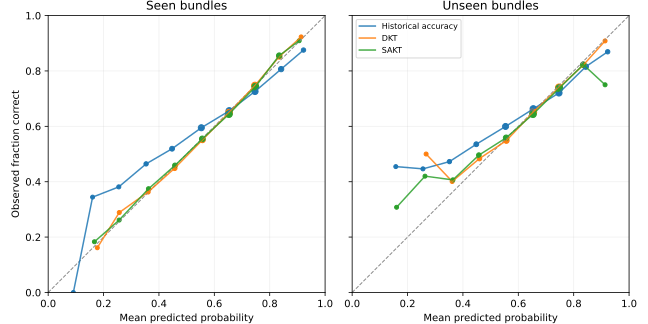

# Next-response prediction on seen and unseen bundles

We trained compact implementations of DKT and SAKT from scratch on the same 5,000-student EdNet sample used for the risk baseline. Each model saw up to 50 earlier responses and used the first listed skill tag and TOEIC part as its question features. The historical baseline used the same window with one correct and one incorrect pseudo-count.

The split holds out roughly one fifth of question bundles by a fixed hash. Held-out responses never enter training, validation, or model histories. Test targets come from the same 659 students in both groups. There were 119,423 seen-bundle and 29,727 unseen-bundle targets, including 148 unseen-bundle targets whose tag and part combination was absent from training. These used a zero embedding. The two groups differ in their question mix and are not matched by difficulty.

| Model | Seen AUC | Unseen AUC | Seen average precision | Unseen average precision | Seen log loss | Unseen log loss |
|---|---:|---:|---:|---:|---:|---:|
| Historical accuracy | 0.629 | 0.624 | 0.761 | 0.766 | 0.618 | 0.615 |
| DKT | 0.655 | 0.633 | 0.780 | 0.769 | 0.603 | 0.607 |
| SAKT | 0.655 | 0.630 | 0.781 | 0.764 | 0.603 | 0.610 |

The sequence-model scores are means across seeds 42, 43, and 44. Both models improve on historical accuracy for seen bundles. On unseen bundles the AUC gains shrink to about 0.009 for DKT and 0.006 for SAKT. SAKT's unseen average precision is slightly below the baseline. These are descriptive results for one student and bundle split.

On the same seen-bundle targets with at least 50 historical answers, reducing the history to 5 answers lowered AUC from 0.645 to 0.609 for DKT and from 0.644 to 0.600 for SAKT. This measures the effect of truncation on active students. The full per-seed results, Brier scores, and training logs are in [knowledge_tracing.json](knowledge_tracing.json).

After preparing EdNet as described in the README, install PyTorch for your device and run:

```powershell
python scripts/train_knowledge_tracing.py --input work/ednet/interactions.csv --output work/ednet/knowledge_tracing.json --epochs 6 --width 32
```

The reported run used PyTorch 2.11.0+cu128 and an RTX 4070 Laptop GPU. We selected each checkpoint by validation log loss. This experiment predicts answer correctness. The separate [risk baseline](risk_baseline.md) predicts low accuracy over the next 20 answers.

## Confidence intervals and calibration

We reran the same settings and averaged each model's three predicted probabilities before scoring. The table above averages three separate AUCs, so its values differ slightly. The intervals below use 1,000 bootstrap draws of the 659 test students, with the same draws for seen and unseen bundles. The intervals cover test student sampling for these fitted models and this bundle split.

| Model | Seen AUC (95% CI) | Unseen AUC (95% CI) | Seen minus unseen (95% CI) |
|---|---|---|---|
| Historical accuracy | 0.629 (0.581 to 0.659) | 0.624 (0.576 to 0.652) | 0.005 (-0.003 to 0.015) |
| DKT | 0.658 (0.621 to 0.682) | 0.636 (0.597 to 0.660) | 0.022 (0.016 to 0.033) |
| SAKT | 0.660 (0.620 to 0.684) | 0.634 (0.594 to 0.660) | 0.025 (0.018 to 0.036) |

Both sequence models lose AUC on unseen bundles in this split. The historical baseline's interval for the difference includes zero. The groups have different questions, so this comparison does not isolate the effect of bundle novelty from other differences in question mix.



Each dot compares the mean predicted probability with the fraction of correct answers in a 0.1-wide probability bin. Larger dots represent more examples. DKT and SAKT have lower Brier scores than historical accuracy on both groups. Brier score also reflects discrimination, so see the curves for how the probabilities agree with observed accuracy.

Add `--diagnostics work/ednet/kt_diagnostics` to the command above to reproduce the plots and intervals. The [aggregate diagnostic data](kt_diagnostics/diagnostics.json) include bin counts and Brier scores.
